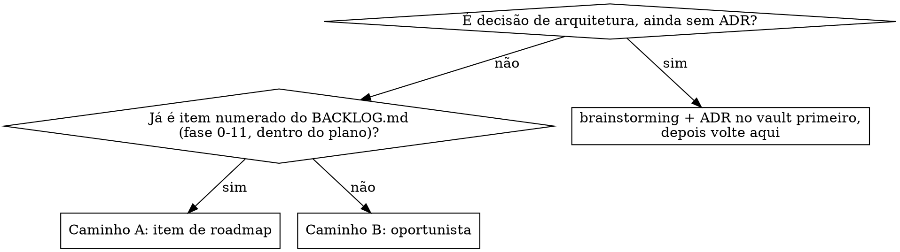

# create-issue — spec (Aceite) + issue no GitHub

Formaliza como uma necessidade nova (bug, hardening, follow-up de review, item de roadmap)
virar uma issue em `endydragonn/GerenciadorEventos` cuja spec — o corpo com `## Aceite` — é
consumível pelo pipeline `implement-issue` (que lê título/corpo/labels no passo 1 e usa as
labels pra ativar skills no passo 1.5).

## Dois caminhos — escolha antes de escrever



- **Caminho A (roadmap):** estende a numeração 1–46 do `BACKLOG.md` (raro — as 46 já viraram
  issues #2–#47). Só se o usuário está mesmo expandindo o plano de fases.
- **Caminho B (oportunista):** o caso comum. Bug achado numa review, hardening não-bloqueante,
  débito técnico, follow-up. **Sem linha no `BACKLOG.md`.** Precedente real: #78, #57, #58 —
  todas fora da numeração 1–46, criadas durante o trabalho de outra issue.
- **Não é nenhum dos dois** (é uma decisão de arquitetura — trade-off, escolha de tecnologia,
  mudança de escopo do sistema): pare aqui, use `superpowers:brainstorming` e registre a ADR
  no vault primeiro. Issue referencia a ADR pelo nome; nunca pelo caminho absoluto do vault
  (`D:\Claude\Brain\...` não entra no corpo — mesma regra de "vault ≠ git" do `implement-issue`,
  vale pra issue tanto quanto pra PR/commit).

## Antes de escrever: confira o vocabulário real

Labels são **case-sensitive e fixas** — `gh issue create --label` falha numa label que não
existe. Confira a lista atual (pode ter mudado desde a tabela abaixo):

```
gh label list -R endydragonn/GerenciadorEventos
```

| Categoria | Labels existentes |
|---|---|
| Fase | `fase/0` … `fase/11` |
| Área | `area/backend`, `area/banco`, `area/infra`, `area/frontend`, `area/eventos`, `area/carga` |
| Tipo | `bug`, `enhancement`, `documentation`, `question`, `good first issue`, `help wanted` |
| Projeto | `artigo` (entregável do TCC), `seguranca`, `bloqueado/docker` |

Toda issue precisa de **ao menos uma `area/*`** — é o que o passo 1.5 do `implement-issue` usa
pra decidir quais skills o gerador/revisor/validador carregam (`area/banco` →
`supabase-postgres-best-practices`, `area/frontend` → `impeccable`, etc.). Issue sem `area/*`
faz o pipeline perder essas skills silenciosamente.

## Escrever a spec (corpo da issue)

**Obrigatório: `## Aceite` com critérios em bullets, um por linha, verificáveis.** Não um
parágrafo único — o `spec-validator` do `implement-issue` monta uma tabela critério→PASS/FAIL
e precisa de linhas discretas pra checar (issues antigas em parágrafo único, ex. #10, forçaram
o validador a quebrar o texto sozinho; não repita isso em issue nova).

Seções, na ordem (as duas primeiras e a última são as únicas obrigatórias):

1. **Contexto/origem** (1 parágrafo ou frase) — de onde isso veio: "Achado na revisão da #5
   (PR #55)", "Fase 1 — pré-requisito estrutural da Fase 2 (fora da numeração 1–46)", etc.
2. `## Contexto` **ou** `## Problema` — prosa: o que está errado / o que falta, e por quê
   importa agora.
3. `## Aceite` (**obrigatório**) — bullets verificáveis.
4. `## Fora de escopo — NÃO fazer aqui` (opcional) — quando há risco real de escopo vazar pra
   uma issue vizinha (ex. #78 deixou explícito que auth não muda ali, é a #57).
5. `## Depende de` — `#N` (uma por linha) ou `—`. Confira que cada `#N` existe:
   `gh issue view N -R endydragonn/GerenciadorEventos --json state`.
6. `## Precede` (opcional) — o que essa issue destrava.
7. Rodapé em itálico citando a origem real: `_Refs #N, PR #M. Origem: revisão code-reviewer
   AAAA-MM-DD._` — nunca um caminho do vault, nunca tratar nota do vault como parte do diff.

**Caminho A (roadmap) muda dois pontos:** título vira `NN · Título` (dois dígitos, zero-padded,
ex. `09 ·`); e o rodapé é `_Parte do roadmap `BACKLOG.md` (item N)._` — **sem** prometer
`issue #(N+1)`: essa fórmula só vale pros itens 1–46 (import em lote de 2026-09-02, onde os
números do GitHub calharam de ser sequenciais). Issue nova pode cair em qualquer número — anote
o número real que o GitHub deu na linha do `BACKLOG.md`, não calcule.

## Mostrar antes de criar

`gh issue create` é uma ação visível pra fora — **mostre o título, corpo e labels ao usuário e
espere confirmação** antes de rodar. Depois de aprovado:

```
gh issue create -R endydragonn/GerenciadorEventos --title "<título>" --body-file <arquivo> \
  --label "area/backend" --label "fase/1"
```

**Caminho A:** depois de criada, adicione a entrada em `BACKLOG.md` na seção `## Fase N` certa,
no formato das 46 existentes (`### <item>. <título>` / linha de labels / `- **Aceite:** ...` /
`- **Depende de:** ...`). Isso é uma edição de arquivo versionado fora do fluxo de issue — **só
commit/push se o usuário pedir** (regra do `CLAUDE.md`); diga que a edição está pronta pra
revisão.

## Depois de criada

Não implemente na hora. Se o usuário quiser seguir direto, use `/implement-issue <N>` com o
número recém-criado — esta skill só cobre até a issue existir com spec completa.

## Erros comuns

| Erro | Correção |
|---|---|
| Label que não existe no repo | `gh label list` antes de criar; nunca invente uma nova sem avisar o usuário |
| `## Aceite` em parágrafo único | Quebre em bullets — cada um é uma linha da tabela do `spec-validator` |
| Issue sem `area/*` | Pipeline não ativa as skills certas no passo 1.5 — sempre inclua |
| Assumir `issue #(N+1)` pra item novo do BACKLOG | Só vale pros itens 1–46; anote o número real |
| Citar caminho do vault (`D:\Claude\Brain\...`) no corpo | Referencie a ADR pelo nome; vault ≠ git |
| Criar a issue sem mostrar o rascunho antes | `gh issue create` é visível pra fora — sempre confirme antes |

## Skills complementares

- `superpowers:brainstorming` — antes desta, se a necessidade ainda é uma decisão de
  arquitetura sem ADR.
- `implement-issue` (`.claude/skills/implement-issue/SKILL.md`) — consome o que esta skill
  produz; passo 1.5 mapeia as labels aqui escolhidas para as skills do gerador/revisor.
