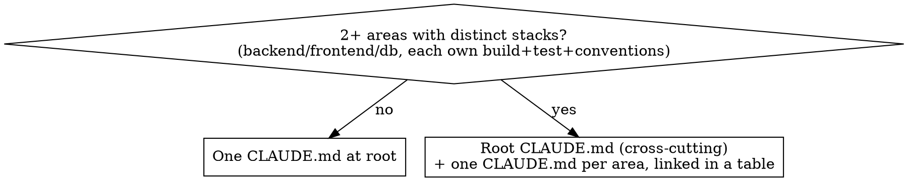

# generating-claude-md

## Overview

Turns a repo's real structure plus any PRD/spec into CLAUDE.md documentation, following the
layered pattern used in the GerenciadorEventos project: one root doc with cross-cutting rules,
area-specific docs only where areas genuinely differ, and every claim checked against the code
— never against the aspiration. If CLAUDE.md files already exist, propose the update as a
staged diff for the user to accept — never edit them in place.

## When to use

- Onboarding a repo that has no CLAUDE.md / AGENTS.md.
- Existing CLAUDE.md contradicts the code (stale commands, old stack, missing new area).
- A PRD/spec/README documents intent well beyond what's actually built.

Not for: a one-line fix to one already-accurate section — just `Edit` it directly. This skill
is for structural (re)generation, not small corrections.

## Structure: one file or several?



Don't split out an area just because the folder exists — a near-empty `frontend/` with no
conventions yet doesn't earn its own file. Split only when an area has real, area-specific
rules that would otherwise dilute the root doc.

## Standard sections (root doc)

Pull these from what a mature root CLAUDE.md (e.g. GerenciadorEventos's) actually contains —
include only what the repo has evidence for; say explicitly when something doesn't apply yet:

| Section | Source of truth | Skip if |
|---|---|---|
| Links to area docs | folder structure | single-file repo |
| Idioma | language of existing code/comments/commits | ambiguous — ask, don't guess |
| Git | actual branch/commit history, `CONTRIBUTING.md`, PR templates | no history to infer from — ask |
| Segredos | `.env.example`, config loaders, secret-reading code | no secrets in repo |
| Código | linters, style configs, "don't do X" markers in code/comments | nothing distinctive found |
| Rodar e testar | `package.json` scripts, `Makefile`, CI config, README | none exist — say so, don't invent |
| Documentação de arquitetura / PRD | PRD.md, ADRs, `docs/` | none exist |

## Mining the PRD: decided vs. implemented

For every capability the PRD/spec describes, check the code. If it isn't there, say so
explicitly — don't drop it silently and don't present it as done:

```markdown
**Decidido, não implementado:** pagamento via Stripe Connect (PRD diz v2); notificação por
e-mail via SendGrid (PRD diz fase 2). Nada disso existe no código ainda.
```

Never invent a command, dependency, or convention that isn't evidenced in the repo just
because the PRD implies it should exist — verify against `package.json`/lockfiles/imports.

## Existing CLAUDE.md files: never edit in place

**If any CLAUDE.md/AGENTS.md already exists anywhere in the repo, do not open it with `Edit`.**
Read every existing one, draft the updated version, and write it to a mirrored path under
`Claude_Refactor/` at the repo root instead — the user decides whether to accept it.

```
repo/CLAUDE.md                 → repo/Claude_Refactor/CLAUDE.md
repo/backend/CLAUDE.md         → repo/Claude_Refactor/backend/CLAUDE.md
```

Report, per file: what changed and why (stale command, missing new area, contradicted PRD
item). The user merges accepted files into place themselves, or asks you to.

**Why this is a rule, not a suggestion:** regenerating docs looks like "just update the file" —
the shortcut is editing in place, which silently destroys whatever a human wrote by hand, with
no review step. Staging costs one extra folder and buys the user a diff to approve or reject.

| Excuse | Reality |
|---|---|
| "It's obviously stale, just fix it" | Stale to you might be intentional to them — stage it, let them confirm |
| "Editing in place is faster" | Writing to `Claude_Refactor/` is one write call, not a redesign |
| "It's only a small tweak" | Small tweaks to accurate sections aren't in scope here — see When to use |
| "No one will mind" | You don't know that — the review step is the whole point |

## Common mistakes

- Splitting into area docs for folders that don't have area-specific rules yet.
- Presenting PRD aspirations as current capabilities.
- Writing secrets' actual values into the doc — placeholders only (`<...>`).
- Overwriting an existing CLAUDE.md instead of staging it in `Claude_Refactor/`.
