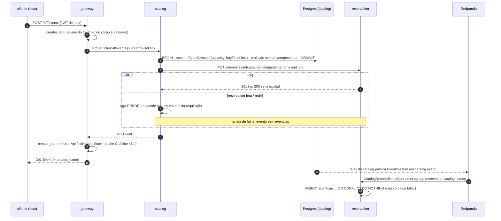

# Fase 7 — serviços extraídos: os saltos `gateway → reservation` e `gateway → catalog`

Mapa do que a Fase 7 entregou até a issue #35: `notification` (#32), `reservation` (#33) e `catalog` (#35) saíram do monólito e viraram
**processos, imagens, containers e schemas próprios**. O monólito restante (`identity`, `gateway`) fala com o `reservation` e com o
`catalog` **por HTTP** (rede `gerenciador-net`, sem porta no host) e com o `notification` só por evento no backbone; o `catalog` também
chama o `reservation` (capacidade). O diagrama de command → evento → projeção → replay da Fase 6 continua valendo, agora **dentro do
`reservation` e do `catalog`**, cada um com event store próprio:
[`fase6-cqrs-es.md`](fase6-cqrs-es.md). A decisão de separar está na ADR
[Microservices Split](../adr/Architecture-Decision-Microservices-Split.md); o event store por serviço, na ADR
[Event Backbone e Event Store](../adr/Architecture-Decision-Event-Backbone-Event-Store.md). Detalhes de código e configuração em
`Projeto/Backend/CLAUDE.md` ("Serviço reservation", "Serviço catalog", "Serviço notification").

> As chamadas `/internal/**` carregam o header `X-Internal-Token` (token de serviço compartilhado, `INTERNAL_API_TOKEN`); sem ele o
> reservation e o catalog respondem 401. Só o `gateway` valida o JWT do usuário e o papel de host; JWT assimétrico + JWKS é a #36.

## Topologia

```mermaid
flowchart LR
  FE["frontend (Flutter Web)<br/>nginx :8088"] -->|"/bff/**"| GW

  subgraph MONO["monolito — container gerenciador-backend :8081 (Tomcat 300, Hikari 350)"]
    direction TB
    GW["gateway<br/>/bff/** (EventWalletGateway, CreatorNames)<br/>JWT, host, dono do evento"]
    ID["identity<br/>users, mywallet"]
    GW --> ID
  end

  subgraph CATS["catalog — container gerenciador-catalog :8083 (só na rede; Tomcat 300, Hikari 100)"]
    direction TB
    CAPI["API interna /internal/events/**"]
    CAT["EventService + CatalogEventWriter<br/>event, eventpresenter (schema catalog)<br/>stream catalog.event"]
    CAPI --> CAT
  end

  subgraph RES["reservation — container gerenciador-reservation :8082 (só na rede; Tomcat 300, Hikari 1000)"]
    direction TB
    API["API interna /internal/**<br/>reservar · confirmar · cancelar · disponibilidade · eventcap"]
    WAL["EventWalletService<br/>CAS em eventcap + walletevent (ES)"]
    JOB["ReservationExpiryService<br/>IdempotencyKeyRetentionService"]
    PRJ["EventAvailabilityConsumer<br/>(projeção event_availability)"]
    REC["CatalogReconciliationConsumer<br/>(cria o eventcap que faltar)"]
    API --> WAL
  end

  subgraph NOT["notification — container gerenciador-notification (sem HTTP)"]
    NC["NotificationConsumer<br/>e-mail por SMTP"]
  end

  GW ==>|"HTTP (pool 400, keep-alive)<br/>cas: 1 chamada · naive: 2 chamadas"| API
  GW ==>|"HTTP (pool 400, resp. 15 s, sem retry)<br/>CRUD, busca, exists (cache 30 s), imagem"| CAPI
  CAT ==>|"HTTP: criar/atualizar/ler/remover eventcap<br/>capacidade nas leituras"| API

  DB[("Postgres (Supavisor, mesmo tenant)<br/>public · catalog · reservation · notification")]
  MONO --> DB
  CATS --> DB
  RES --> DB
  NOT --> DB

  RP[["Redpanda"]]
  CAT -->|"relay catalog.event_outbox<br/>tópico catalog.event"| RP
  ID -->|"relay public.event_outbox<br/>identity.notification"| RP
  WAL -->|"relay reservation.event_outbox<br/>tópico reservation.wallet"| RP
  RP -->|reservation.wallet| PRJ
  RP -->|"catalog.event (EventCreated)"| REC
  RP -->|identity.notification| NC
```



## O salto no braço `cas` e no braço `naive`

```mermaid
sequenceDiagram
  autonumber
  participant C as cliente (k6)
  participant G as gateway (monólito)
  participant R as reservation
  participant P as Postgres

  Note over C,P: braço cas (RESERVATION_READPATH=cas) — UMA chamada, CAS atômico no reservation
  C->>G: POST /bff/event-wallets (Idempotency-Key)
  G->>P: carteira existe? (public)
  Note over G: evento existe? desde a #35, GET /internal/events/{id}/exists no catalog (positivo em cache 30 s; catalog fora = 503)
  G->>R: POST /internal/reservations?path=cas
  R->>P: SELECT eventcap, existsActive
  R->>P: BEGIN · claim da chave · UPDATE eventcap (CAS) · UPSERT walletevent · append SlotReserved · COMMIT
  R-->>G: 201 pending (+ header Idempotency-Key)
  G-->>C: 201

  Note over C,P: braço naive (RESERVATION_READPATH=naive) — DUAS chamadas; a janela check-then-act inclui a rede
  C->>G: POST /bff/event-wallets
  G->>P: carteira existe? (public) · evento existe? (catalog, como acima)
  G->>R: GET /internal/events/{id}/availability
  R->>P: eventcap LEFT JOIN event_availability (projeção defasada)
  R-->>G: {"available": n}
  alt n == 0
    G-->>C: 400 Evento lotado (sem a 2ª chamada)
  else n > 0 ou -1
    G->>R: POST /internal/reservations?path=naive
    R->>P: BEGIN · claim da chave · UPSERT walletevent (SEM CAS) · append SlotReserved · COMMIT
    R-->>G: 201 pending
    G-->>C: 201
  end
```

## Criação do evento: `eventcap` por chamada síncrona + reconciliação



O `creator_name` é **composto no `gateway`** (consulta em lote ao `identity` + cache), não projetado no `catalog`: o `catalog` só guarda o
`creator_id` (integer, referência solta, sem FK). Conta desativada = `creator_name` nulo. O dono (`creator_id` do evento == usuário do token)
é exigido pelo gateway em PUT, DELETE e upload de imagem (403).

## O que cada serviço enxerga

| | `public` (monólito) | `catalog` | `reservation` | `notification` |
|---|---|---|---|---|
| `users`, `mywallet` | lê e escreve | — | — | — |
| `event`, `eventpresenter` | — | lê e escreve | — | — |
| `eventcap`, `walletevent`, `idempotency_key`, `event_availability` | — | — | lê e escreve | — |
| event store (`event_store`, `event_outbox`, `projection_checkpoint`, `event_snapshot`) | o do monólito: `identity.notification` | o do serviço: `catalog.event` | o do serviço: `reservation.wallet` | — |
| `processed_event` | — | — | — | lê e escreve |

Nenhum serviço lê tabela de outro e **não há FK cross-schema** (nem nas tabelas do `reservation`). O que as FKs garantiam virou chamada:
o gateway confere carteira e evento (no `catalog`) antes de reservar e confere o criador no `identity`; o catalog remove o `eventcap` por HTTP
(409 se há reserva do evento, o antigo `RESTRICT`).

## Janelas de falha (sem atomicidade distribuída)

- **Evento criado, `eventcap` não**: a chamada síncrona falhou. A criação responde normalmente; o `EventCreated` do tópico faz o
  `reservation` criar o que faltou quando voltar (reservar nesse intervalo: "Capacidade do evento não configurada").
- **Capacidade removida, evento mantido**: o `reservation` apagou o `eventcap` (cancelamento) e o commit do catalog falhou depois. Raro; o
  evento fica sem `eventcap`.
- **`reservation` fora**: reservar, confirmar, cancelar, listar inscrições, **ler/listar/buscar eventos** (a resposta de `Event` leva a
  capacidade, que vem do serviço) e **apagar evento** (a remoção do `eventcap` vem antes da transação do catalog, que então nem começa)
  falham com erro de rede; login e cadastro seguem. Criar evento não falha (ver a primeira janela).
- **`catalog` fora** (#35): ler/listar/buscar/criar/editar/apagar evento e **reservar** respondem **503** genérico no gateway (a conferência
  do evento na reserva nunca vira "Evento não encontrado"; um positivo de `exists` ainda no cache de 30 s deixa a reserva seguir). Criar
  evento com o catalog lento responde 503 "resultado incerto, confira em Meus eventos" (o timeout de 15 s pode vencer depois do commit).
  Login, cadastro, carteira e "minhas reservas" seguem.
- **Editar evento com o `reservation` fora** (#60): o `PATCH` da capacidade roda ANTES da transação do catalog; se falha (serviço fora, 400, 409),
  **nada é gravado no catalog** (nem metadados nem apresentadores) e a edição inteira falha. Metadados e apresentadores entram numa única
  transação do catalog. Janela restante: o reservation atualizou e a transação do catalog falhou (capacidade nova, metadados antigos; repetir o
  PUT converge). O `PATCH` num evento SEM `eventcap` responde 404 e o catalog o cria com os valores novos, em vez de perder a edição para a
  reconciliação.
- **Apagar evento**: o catalog chama `DELETE /internal/eventcaps/{id}` ANTES da transação (sem segurar conexão nem lock durante o salto de
  rede; o 409 de evento com reserva acontece antes de qualquer escrita). Se o reservation apagou a capacidade e a transação do catalog falha em
  seguida, o evento fica sem `eventcap`.
