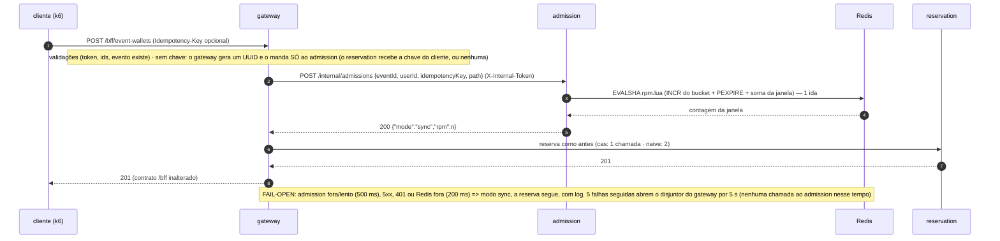
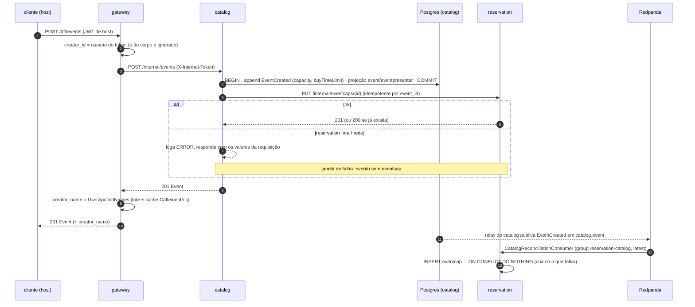
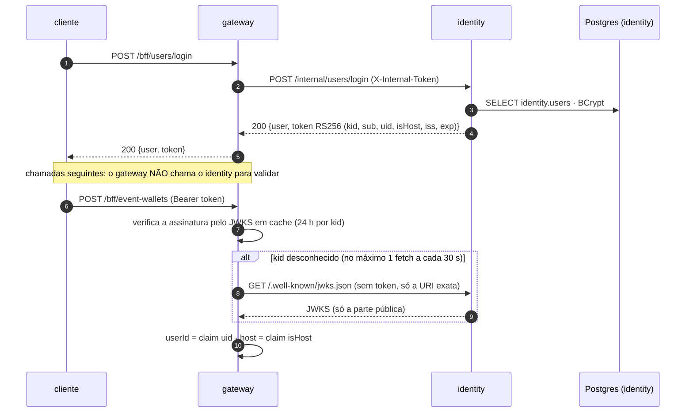

# Fase 7 — serviços extraídos: os saltos `gateway → reservation`, `gateway → catalog` e `gateway → identity`

Mapa do que a Fase 7 entregou até a issue #36: `notification` (#32), `reservation` (#33), `catalog` (#35) e `identity` (#36) saíram do monólito e viraram
**processos, imagens, containers e schemas próprios**. O que sobrou no monólito é só o `gateway` (`/bff/**`, validação do JWT); ele fala com o `reservation`, o
`catalog` e o `identity` **por HTTP** (rede `gerenciador-net`, sem porta no host) e com o `notification` só por evento no backbone; o `catalog` também
chama o `reservation` (capacidade). O diagrama de command → evento → projeção → replay da Fase 6 continua valendo, agora **dentro do
`reservation` e do `catalog`**, cada um com event store próprio:
[`fase6-cqrs-es.md`](fase6-cqrs-es.md). A decisão de separar está na ADR
[Microservices Split](../adr/Architecture-Decision-Microservices-Split.md); o event store por serviço, na ADR
[Event Backbone e Event Store](../adr/Architecture-Decision-Event-Backbone-Event-Store.md). Detalhes de código e configuração em
`Projeto/Backend/CLAUDE.md` ("Serviço reservation", "Serviço catalog", "Serviço identity", "Serviço notification").

> As chamadas `/internal/**` carregam o header `X-Internal-Token` (token de serviço compartilhado, `INTERNAL_API_TOKEN`); sem ele o
> reservation, o catalog e o identity respondem 401 (a única exceção é `GET /.well-known/jwks.json` do identity, só pela URI exata). O
> `identity` assina o JWT (RS256, `kid`, claims `uid` e `isHost`); o `gateway` o valida **sem estado** pelo JWKS em cache (identity fora não
> derruba quem já tem token) e é quem confere o papel de host e o dono do evento, lendo as claims.

> **Issue #41 (Batch 2):** o `admission` (container `gerenciador-admission`, `:8085` só na rede, **sem datasource**) e o Redis (`gerenciador-redis`, só o `admission` o usa) entram no desenho:
> o `gateway` conta cada tentativa de reserva num contador de RPM por evento (ver "O salto de contagem"). O modo é sempre `sync` e a falha dele é **fail-open**; o `backend` não depende dele.

## Topologia

```mermaid
flowchart LR
  FE["frontend (Flutter Web)<br/>nginx :8088"] -->|"/bff/**"| GW

  subgraph MONO["monolito — container gerenciador-backend :8081 (Tomcat 300, Hikari 10)"]
    direction TB
    GW["gateway<br/>/bff/** (EventWalletGateway, CreatorNames)<br/>valida o JWT RS256 (JWKS em cache), host e dono do evento por claim"]
  end

  subgraph IDS["identity — container gerenciador-identity :8084 (só na rede; Tomcat 300, Hikari 100)"]
    direction TB
    IAPI["API interna /internal/**<br/>users · registrations · wallets · recaptcha<br/>GET /.well-known/jwks.json (sem token)"]
    IDS2["UserService, EmailVerificationService, JwtIssuer<br/>users, mywallet, pending_verifications (schema identity)<br/>chave RSA no volume identity-keys"]
    IAPI --> IDS2
  end

  subgraph CATS["catalog — container gerenciador-catalog :8083 (só na rede; Tomcat 300, Hikari 100)"]
    direction TB
    CAPI["API interna /internal/events/**"]
    CAT["EventService + CatalogEventWriter<br/>event, eventpresenter (schema catalog)<br/>stream catalog.event"]
    CAPI --> CAT
  end

  subgraph RES["reservation — container gerenciador-reservation :8082 (só na rede; Tomcat 300, Hikari 1000)"]
    direction TB
    API["API interna /internal/**<br/>reservar · confirmar · cancelar · disponibilidade · eventcap"]
    WAL["EventWalletService<br/>CAS em eventcap + walletevent (ES)"]
    JOB["ReservationExpiryService<br/>IdempotencyKeyRetentionService"]
    PRJ["EventAvailabilityConsumer<br/>(projeção event_availability)"]
    REC["CatalogReconciliationConsumer<br/>(cria o eventcap que faltar)"]
    API --> WAL
  end

  subgraph ADM["admission — container gerenciador-admission :8085 (só na rede; Tomcat 300, SEM datasource)"]
    direction TB
    AAPI["API interna /internal/admissions<br/>POST (conta e devolve o modo) · GET .../events/{id}/rpm"]
    CNT["RpmCounter<br/>script Lua: buckets de 50 ms, janela de 200 ms"]
    AAPI --> CNT
  end
  REDIS[("Redis — gerenciador-redis<br/>só na rede · requirepass · sem persistência · maxmemory 256 MB")]
  CNT -->|"1 ida (Lua): INCR + PEXPIRE + soma dos buckets"| REDIS

  subgraph NOT["notification — container gerenciador-notification (sem HTTP)"]
    NC["NotificationConsumer<br/>e-mail por SMTP"]
  end

  GW ==>|"HTTP (pool 400, resp. 5 s, sem retry)<br/>login, cadastro, MFA, /me, carteira, nomes em lote"| IAPI
  GW -.->|"GET /.well-known/jwks.json<br/>cache 24 h por kid, 1 fetch / 30 s"| IAPI
  GW ==>|"HTTP (pool 400, conectar/pool 200 ms, resp. 500 ms, FAIL-OPEN + disjuntor)<br/>1 chamada por POST /bff/event-wallets, nos dois braços"| AAPI
  GW ==>|"HTTP (pool 400, keep-alive)<br/>cas: 1 chamada · naive: 2 chamadas"| API
  GW ==>|"HTTP (pool 400, resp. 15 s, sem retry)<br/>CRUD, busca, exists (cache 30 s), imagem"| CAPI
  CAT ==>|"HTTP: criar/atualizar/ler/remover eventcap<br/>capacidade nas leituras"| API

  DB[("Postgres (Supavisor, mesmo tenant)<br/>public · identity · catalog · reservation · notification")]
  MONO --> DB
  IDS --> DB
  CATS --> DB
  RES --> DB
  NOT --> DB

  RP[["Redpanda"]]
  CAT -->|"relay catalog.event_outbox<br/>tópico catalog.event"| RP
  IDS2 -->|"relay identity.event_outbox<br/>identity.notification · identity.user"| RP
  WAL -->|"relay reservation.event_outbox<br/>tópico reservation.wallet"| RP
  RP -->|reservation.wallet| PRJ
  RP -->|"catalog.event (EventCreated)"| REC
  RP -->|identity.notification| NC
```



## O salto de contagem (#41)



Custo no caminho síncrono: **+1 ida HTTP keep-alive gateway → admission e +1 ida admission → Redis** por reserva (a opção "gateway direto no Redis" seria 1 ida; a spec escolheu o salto ao `admission` porque o modo
do evento, na #43, depende do estado da fila e só o `admission` terá Redis e RabbitMQ). O custo real é medido num mini dry-run (X baixo) e registrado no `Projeto/Backend/CLAUDE.md`.

## O salto no braço `cas` e no braço `naive`

```mermaid
sequenceDiagram
  autonumber
  participant C as cliente (k6)
  participant G as gateway (monólito)
  participant R as reservation
  participant P as Postgres

  Note over C,P: braço cas (RESERVATION_READPATH=cas) — UMA chamada, CAS atômico no reservation
  C->>G: POST /bff/event-wallets (Idempotency-Key)
  Note over G: uid vem do claim do token (sem consulta; a carteira nasce com o usuário e o gateway deixou de conferi-la, #36)
  Note over G: evento existe? desde a #35, GET /internal/events/{id}/exists no catalog (positivo em cache 30 s; catalog fora = 503)
  G->>R: POST /internal/reservations?path=cas
  R->>P: SELECT eventcap, existsActive
  R->>P: BEGIN · claim da chave · UPDATE eventcap (CAS) · UPSERT walletevent · append SlotReserved · COMMIT
  R-->>G: 201 pending (+ header Idempotency-Key)
  G-->>C: 201

  Note over C,P: braço naive (RESERVATION_READPATH=naive) — DUAS chamadas; a janela check-then-act inclui a rede
  C->>G: POST /bff/event-wallets
  Note over G: uid do claim · evento existe? (catalog, como acima)
  G->>R: GET /internal/events/{id}/availability
  R->>P: eventcap LEFT JOIN event_availability (projeção defasada)
  R-->>G: {"available": n}
  alt n == 0
    G-->>C: 400 Evento lotado (sem a 2ª chamada)
  else n > 0 ou -1
    G->>R: POST /internal/reservations?path=naive
    R->>P: BEGIN · claim da chave · UPSERT walletevent (SEM CAS) · append SlotReserved · COMMIT
    R-->>G: 201 pending
    G-->>C: 201
  end
```

## Criação do evento: `eventcap` por chamada síncrona + reconciliação



O `creator_name` é **composto no `gateway`** (consulta em lote ao `identity` + cache), não projetado no `catalog`: o `catalog` só guarda o
`creator_id` (integer, referência solta, sem FK). Conta desativada = `creator_name` nulo. O dono (`creator_id` do evento == usuário do token)
é exigido pelo gateway em PUT, DELETE e upload de imagem (403).

## O que cada serviço enxerga

| | `monolito` (gateway) | `identity` | `catalog` | `reservation` | `notification` |
|---|---|---|---|---|---|
| `users`, `mywallet`, `pending_verifications` | — | lê e escreve (schema `identity`) | — | — | — |
| `event`, `eventpresenter` | — | — | lê e escreve | — | — |
| `eventcap`, `walletevent`, `idempotency_key`, `event_availability` | — | — | — | lê e escreve | — |
| event store (`event_store`, `event_outbox`, `projection_checkpoint`, `event_snapshot`) | — (o `public` ficou só com a infra da lib `shared`) | o do serviço: `identity.notification` (congelado) e `identity.user` | o do serviço: `catalog.event` | o do serviço: `reservation.wallet` | — |
| `processed_event` | — | — | — | — | lê e escreve |

Nenhum serviço lê tabela de outro e **não há FK cross-schema** (nem nas tabelas do `reservation`; `mywallet` mora no schema `identity` com
`users` justamente porque a FK e o trigger 1:1 entre as duas só cabem no mesmo schema). O que as FKs garantiam virou chamada ou claim:
o gateway confere o evento (no `catalog`) antes de reservar e o criador no `identity`; o `uid` do usuário vem **assinado no token** (nenhuma
consulta ao `identity` por reserva) e a carteira nasce no mesmo `INSERT` do usuário; o catalog remove o `eventcap` por HTTP
(409 se há reserva do evento, o antigo `RESTRICT`).

## Login, JWT e validação sem estado (#36)



Consequências do desenho sem estado: desativar a conta, trocar a senha ou mudar `host` só valem para tokens **novos** (um token emitido
segue válido até `exp`, 10 h por padrão); um `uid` que não existe mais não dá 401 em `event-wallets`. A chave RSA é gerada no 1º boot do
`identity` e fica no volume `identity-keys` (sobrevive a restart/rebuild; `down -v` a apaga e todo token antigo vira 401). Limpar o banco
com `TRUNCATE ... RESTART IDENTITY` recicla o `user_id`: por isso a limpeza entre blocos da carga e o `run-tests.sh` apagam a chave, e o
`backend` (cache de JWKS de até 24 h) tem de ser reiniciado depois do identity.

## Janelas de falha (sem atomicidade distribuída)

- **Evento criado, `eventcap` não**: a chamada síncrona falhou. A criação responde normalmente; o `EventCreated` do tópico faz o
  `reservation` criar o que faltou quando voltar (reservar nesse intervalo: "Capacidade do evento não configurada").
- **Capacidade removida, evento mantido**: o `reservation` apagou o `eventcap` (cancelamento) e o commit do catalog falhou depois. Raro; o
  evento fica sem `eventcap`.
- **`admission` ou Redis fora** (#41): **fail-open**. O gateway segue reservando pelo caminho de hoje (a contagem do evento só perde essas tentativas); o `AdmissionClient` loga com limite de taxa (1 linha a cada 10 s)
  e, depois de 5 falhas seguidas, deixa de chamar o `admission` por 5 s (disjuntor). Token interno diferente nos dois lados (401) também é fail-open, mas logado em ERROR. O `backend` não depende do `admission`
  no compose. Redis lento/fora dentro do `admission`: timeout de 200 ms, comandos rejeitados na hora e resposta **503** (que o disjuntor do gateway conta; um 200 `sync` esconderia o Redis travado e cada reserva pagaria os 200 ms).
- **`reservation` fora**: reservar, confirmar, cancelar, listar inscrições, **ler/listar/buscar eventos** (a resposta de `Event` leva a
  capacidade, que vem do serviço) e **apagar evento** (a remoção do `eventcap` vem antes da transação do catalog, que então nem começa)
  falham com erro de rede; login e cadastro seguem. Criar evento não falha (ver a primeira janela).
- **`catalog` fora** (#35): ler/listar/buscar/criar/editar/apagar evento e **reservar** respondem **503** genérico no gateway (a conferência
  do evento na reserva nunca vira "Evento não encontrado"; um positivo de `exists` ainda no cache de 30 s deixa a reserva seguir). Criar
  evento com o catalog lento responde 503 "resultado incerto, confira em Meus eventos" (o timeout de 15 s pode vencer depois do commit).
  Login, cadastro, carteira e "minhas reservas" seguem.
- **`identity` fora** (#36): login, cadastro (request-verification, verify-email, resend), MFA, troca de senha, `/bff/users/**` (inclusive `/me`) e
  `/bff/my-wallets/**` respondem **503** genérico (nunca 401 nem 500; o 401 com `INTERNAL_API_TOKEN` errado no identity também vira 503). Quem já tem
  token válido **segue reservando e lendo eventos**: o gateway valida pelo JWKS em cache (24 h, tolerante a queda) e lê `uid`/`isHost` do token.
  Com o cache de JWKS vazio (backend recém-subido, identity fora) o token não valida: rota protegida dá 401, rota pública segue anônima. Os
  pedidos de e-mail que o identity ainda não publicou ficam no `identity.event_outbox` e saem quando ele volta. O `creator_name` fica nulo.
- **Editar evento com o `reservation` fora** (#60): o `PATCH` da capacidade roda ANTES da transação do catalog; se falha (serviço fora, 400, 409),
  **nada é gravado no catalog** (nem metadados nem apresentadores) e a edição inteira falha. Metadados e apresentadores entram numa única
  transação do catalog. Janela restante: o reservation atualizou e a transação do catalog falhou (capacidade nova, metadados antigos; repetir o
  PUT converge). O `PATCH` num evento SEM `eventcap` responde 404 e o catalog o cria com os valores novos, em vez de perder a edição para a
  reconciliação.
- **Apagar evento**: o catalog chama `DELETE /internal/eventcaps/{id}` ANTES da transação (sem segurar conexão nem lock durante o salto de
  rede; o 409 de evento com reserva acontece antes de qualquer escrita). Se o reservation apagou a capacidade e a transação do catalog falha em
  seguida, o evento fica sem `eventcap`.
