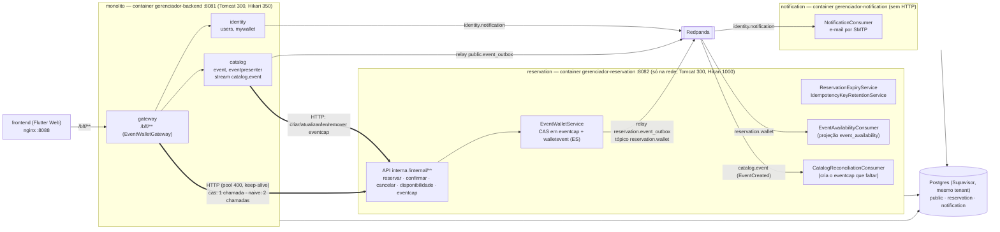
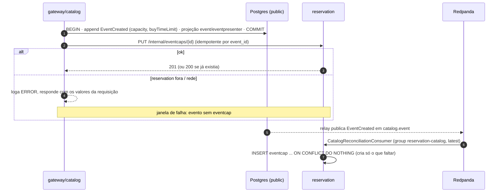

# Fase 7 — serviços extraídos: o salto `gateway → reservation`

Mapa do que a Fase 7 entregou até a issue #33: `notification` (#32) e `reservation` (#33) saíram do monólito e viraram **processos,
imagens, containers e schemas próprios**. O monólito restante (`identity`, `catalog`, `gateway`) fala com o `reservation` **por HTTP**
(rede `gerenciador-net`, sem porta no host) e com o `notification` só por evento no backbone. O diagrama de command → evento → projeção →
replay da Fase 6 continua valendo, agora **dentro do `reservation`**, com event store próprio:
[`fase6-cqrs-es.md`](fase6-cqrs-es.md). A decisão de separar está na ADR
[Microservices Split](../adr/Architecture-Decision-Microservices-Split.md); o event store por serviço, na ADR
[Event Backbone e Event Store](../adr/Architecture-Decision-Event-Backbone-Event-Store.md). Detalhes de código e configuração em
`Projeto/Backend/CLAUDE.md` ("Serviço reservation", "Serviço notification").

## Topologia



## O salto no braço `cas` e no braço `naive`

```mermaid
sequenceDiagram
  autonumber
  participant C as cliente (k6)
  participant G as gateway (monólito)
  participant R as reservation
  participant P as Postgres

  Note over C,P: braço cas (RESERVATION_READPATH=cas) — UMA chamada, CAS atômico no reservation
  C->>G: POST /bff/event-wallets (Idempotency-Key)
  G->>P: carteira existe? evento existe? (public)
  G->>R: POST /internal/reservations?path=cas
  R->>P: SELECT eventcap, existsActive
  R->>P: BEGIN · claim da chave · UPDATE eventcap (CAS) · UPSERT walletevent · append SlotReserved · COMMIT
  R-->>G: 201 pending (+ header Idempotency-Key)
  G-->>C: 201

  Note over C,P: braço naive (RESERVATION_READPATH=naive) — DUAS chamadas; a janela check-then-act inclui a rede
  C->>G: POST /bff/event-wallets
  G->>P: carteira existe? evento existe? (public)
  G->>R: GET /internal/events/{id}/availability
  R->>P: eventcap LEFT JOIN event_availability (projeção defasada)
  R-->>G: {"available": n}
  alt n == 0
    G-->>C: 400 Evento lotado (sem a 2ª chamada)
  else n > 0 ou -1
    G->>R: POST /internal/reservations?path=naive
    R->>P: BEGIN · claim da chave · UPSERT walletevent (SEM CAS) · append SlotReserved · COMMIT
    R-->>G: 201 pending
    G-->>C: 201
  end
```

## Criação do evento: `eventcap` por chamada síncrona + reconciliação



## O que cada serviço enxerga

| | `public` (monólito) | `reservation` | `notification` |
|---|---|---|---|
| `users`, `mywallet`, `event`, `eventpresenter` | lê e escreve | — | — |
| `eventcap`, `walletevent`, `idempotency_key`, `event_availability` | — | lê e escreve | — |
| event store (`event_store`, `event_outbox`, `projection_checkpoint`, `event_snapshot`) | o do monólito: `catalog.event`, `identity.notification` | o do serviço: `reservation.wallet` | — |
| `processed_event` | — | — | lê e escreve |

Nenhum serviço lê tabela de outro e **não há FK cross-schema** (nem nas tabelas do `reservation`). O que as FKs garantiam virou chamada:
o gateway confere carteira e evento antes de reservar; o catalog remove o `eventcap` por HTTP (409 se há reserva do evento, o antigo `RESTRICT`).

## Janelas de falha (sem atomicidade distribuída)

- **Evento criado, `eventcap` não**: a chamada síncrona falhou. A criação responde normalmente; o `EventCreated` do tópico faz o
  `reservation` criar o que faltou quando voltar (reservar nesse intervalo: "Capacidade do evento não configurada").
- **Capacidade removida, evento mantido**: o `reservation` apagou o `eventcap` (cancelamento) e o commit do catalog falhou depois. Raro; o
  evento fica sem `eventcap`.
- **`reservation` fora**: reservar, confirmar, cancelar, listar inscrições, **ler/listar/buscar eventos** (a resposta de `Event` leva a
  capacidade, que vem do serviço) e **apagar evento** (a remoção do `eventcap` vem antes da transação do catalog, que então nem começa)
  falham com erro de rede; login e cadastro seguem. Criar evento não falha (ver a primeira janela).
- **Editar evento com o `reservation` fora**: a transação do `EventUpdated` (metadados) já comitou quando o `PATCH` da capacidade falha, então
  **os metadados ficam gravados e a capacidade não** (a #60, não consertada, já era não atômica). O `PATCH` num evento SEM `eventcap`
  responde 404 e o catalog o cria com os valores novos, em vez de perder a edição para a reconciliação.
- **Apagar evento**: o catalog chama `DELETE /internal/eventcaps/{id}` ANTES da transação (sem segurar conexão nem lock durante o salto de
  rede; o 409 de evento com reserva acontece antes de qualquer escrita). Se o reservation apagou a capacidade e a transação do catalog falha em
  seguida, o evento fica sem `eventcap`.
