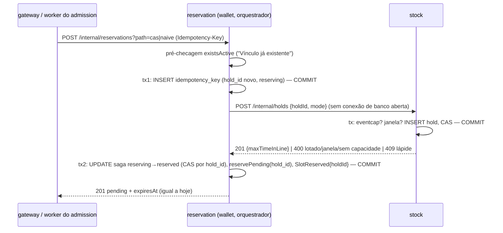

# Design: saga `stock` + `wallet` (issue #47)

Data: 2026-10-29. Padrão a repetir: `reservation` (#33), `catalog` (#35), `identity` (#36) e `admission` (#41–#43). Base: o comentário
`## Atualização de aceite (2026-10-28)` da #47 (é o aceite formal; esta spec decide o que ele deixa em aberto) e a decisão 7 do Batch 2:
a saga entra **depois da Rodada 4** e é medida na **Rodada 5**, sobre a **mesma configuração** da R4 (`admission`, autoescala, slim,
Hikari e X iguais). Só a saga muda entre as duas.

Ponto de partida no código (`35955ef`): o serviço `reservation` guarda `eventcap` (capacidade, CAS relacional) e `walletevent` (reserva,
event sourcing, stream `reservation.wallet`) no mesmo schema. `EventWalletService.reservarNaTransacao` orquestra numa `Connection` só:
`IdempotencyKeyRepository.claim` → `CapacityReserver.tryReserve` → `ReservationWriter.reservePending` → `ReservationEvents.slotReserved` →
commit. A compensação hoje é o `rollback`. `EventCapRepository.release` devolve a vaga por `event_id` (com a trava `quant < capacity`) e
**não é idempotente por chave**: quem impede a devolução dupla é a guarda de `walletevent` na mesma transação (`cancelIfActive`,
`expireIfStale`). No split, essa guarda fica do outro lado da rede.

## Pendências de decisão (o resto da spec assume as recomendações)

| # | Pergunta | Opções (trade-off em uma frase) | Recomendação |
|---|---|---|---|
| D1 | Orquestração ou coreografia na reserva? | **(a) Orquestração síncrona pelo `wallet`**: o `reservation` chama o `stock` por HTTP dentro do pedido, e o 201 `pending` com `expiresAt`, o 400 "Evento lotado" e o read-your-writes seguem iguais (`HttpContractTest` intacto). Custa +1 salto HTTP e +2 commits por tentativa. **(b) Coreografia por eventos** (`SlotRequested` → `stock` consome → `SlotHeld`/`SlotRejected` → `wallet` consome): sem salto síncrono, mas a resposta do `POST` não sabe se havia vaga. O contrato `/bff` mudaria (sempre 202 + consulta) ou o gateway teria de esperar o evento, e toda reserva pagaria o lag do relay + consumer, que na Rodada 2 chegou a ~793 mil mensagens de backlog. | **(a)**. A (b) quebra o aceite ("`HttpContractTest` sem mudança de expectativa") |
| D2 | Onde mora o estado da saga e em que ordem os passos rodam? | **(a) Log primeiro no `wallet`**: a linha da saga é gravada e comitada antes de chamar o `stock`. Conclusão e compensação disputam um `UPDATE` condicional nessa linha, um só ponto de decisão, e não há janela de overselling. Custa +2 commits por tentativa, inclusive na rejeição "lotado", que é o caminho quente sob sobrecarga. **(b) `stock` primeiro, com prazo (lease)**: a rejeição não escreve nada no `wallet` (mais barata). Mas a órfã só é achada do lado do `stock`, que pergunta ao `wallet` em lote se a reserva existe, e uma transação do `wallet` ainda em voo responde "não existe". Fechar isso exige uma cerca de tempo (prazo no relógio do Postgres + margem), e a corretude passa a depender de nenhuma transação demorar mais que a margem. | **(a)**. Overselling > 0 é parada da R5; a R5 deve medir o custo de uma saga sem janela |
| D3 | O `stock` vira serviço escalável? | **(a) Uma réplica fixa** (fora do scaler; Hikari 250 no compose base e no override): a conta do Supavisor fecha sem mexer em nenhum número da R4 (1463 no base, 1489 no override). Escalar não sobe o X por evento: a linha quente do `eventcap` serializa, e o host da carga já era limitado por CPU (X(1) = X(2) na S3). **(b) Escalável como o `reservation`** (até 3 réplicas, slot no `lb`, regra 50/80): com o teto de 1500, cada réplica fica com Hikari ~85 (3 × 85 + 1239 = 1494), abaixo do Tomcat 300. Ganha CPU de parsing se o `stock` saturar, ao custo de mais um serviço no scaler e no harness. | **(a)**, com a saturação do `stock` registrada como achado da R5 se aparecer |
| D4 | Como a vaga volta ao cancelar ou expirar? | **(a) Por evento**: `ReservationCancelled`/`ReservationExpired` já são appendados na transação do `wallet` (outbox) e passam a levar o `holdId`. O `stock` consome `reservation.wallet` e libera o hold, idempotente pelo `holdId`, sem escrita nova nem salto no `wallet` e sem perder devolução (at-least-once). A vaga volta com o lag do consumer: vende-se a menos por um tempo, nunca a mais. **(b) HTTP síncrono**: o `wallet` chama `release` depois do commit, com marca "devolução pendente" e reaper para quando o `stock` está fora. A vaga volta na hora, mas cancelar e expirar ganham +1 salto e +1 escrita, e há um segundo reaper. | **(a)**. O lag de devolução vira métrica da R5 |

Decidido nesta spec, sem pendência (solução única ou trade-off desprezível):
- a forma do split (abaixo);
- o ledger de holds no `stock`;
- a ordem das mensagens de erro;
- o braço `naive` passando pela saga;
- a disponibilidade com a capacidade lida do `stock`.

## Forma do split (decidido)

- **`stock` é o serviço novo** (módulo Maven `stock`, lib `stock-client`, Dockerfile, imagem e container `gerenciador-stock`, API interna
  **`:8086`** só na `gerenciador-net`, schema **`stock`**). Ele leva:
  - o `eventcap` (o CAS);
  - a tabela nova `stock.hold`;
  - toda a API `/internal/eventcaps/**`;
  - o `CatalogReconciliationConsumer` (group renomeado para `stock-catalog`).
- **`reservation` continua com o nome, o container, a porta `:8082` e a API `/internal/reservations*`** e passa a ser o lado `wallet` e o
  **orquestrador**. Ele guarda `walletevent` (ES), `idempotency_key` (agora também o log da saga), a projeção `event_availability`, o
  `ReservationExpiryService`, a retenção e o relay.
  - **Por que manter o nome:** o worker do `admission` (`addLink`/`replay`), o gateway (`RESERVATION_SERVICE_URL`), o
    `FakeReservationServer`/`HttpContractTest`, o `ReservationReplayTest`, o `lb:8082`, o scaler e o `adm:replicas` não mudam.
  - Renomear para `wallet` espalharia a mudança por compose, autoescala, kit de carga e harness, e a R5 deixaria de ter "só a saga"
    como diferença.
- **`catalog`** troca só o alvo da capacidade: `STOCK_SERVICE_URL` (`http://stock:8086`) no lugar de `RESERVATION_SERVICE_URL`, com o
  `StockClient`. O contrato HTTP de `/internal/eventcaps/**` não muda.
- `EventCap` e `EventCapacityApi` saem da lib `reservation-client` para a `stock-client`, e o `ReservationClient` deixa de implementar
  `EventCapacityApi`.
- Nenhum serviço lê tabela de outro. Sem FK entre `stock` e `reservation`. O `ModuleBoundaryArchTest` ganha `stockclient` entre as libs de
  contrato.

## O ledger de holds (`stock.hold`)

Cada tentativa de reserva tem um **`holdId`** (UUID gerado pelo `wallet` no passo 1 da saga). É a `Idempotency-Key` dos passos no `stock`.

```
stock.hold(hold_id uuid PK, event_id integer NOT NULL, user_id integer NOT NULL,
           decremented boolean NOT NULL,      -- true só no braço cas de evento limitado
           status text NOT NULL CHECK (status IN ('held','released')),
           created_at timestamptz NOT NULL DEFAULT now(), updated_at timestamptz NOT NULL DEFAULT now())
índice (event_id, status)
```

- **Reservar** (`POST /internal/holds`, corpo `{holdId, userId, eventId, mode: cas|naive}`), uma transação no `stock`:
  1. `SELECT` do `eventcap`. Sem linha → 400 "Capacidade do evento não configurada"; `buy_time_limit` passado → 400 "Janela de compra
     encerrada para este evento".
  2. `INSERT hold (..., 'held') ON CONFLICT (hold_id) DO NOTHING`. Se a linha já existe é uma repetição: `held` → **200** com o mesmo
     corpo, sem tocar no `eventcap`; `released` → **409** "Hold liberado" (lápide, abaixo).
  3. Só com `mode = cas` e `capacity <> -1`: o CAS de hoje (`UPDATE eventcap SET quant = quant - 1 WHERE ... AND quant >= 1`) como
     **último comando antes do commit**. 0 linhas → rollback (o hold some junto) → 400 "Evento lotado".
  4. Commit → **201** `{holdId, maxTimeInLine}`. O `wallet` calcula o `expiresAt` como hoje (`now + maxTimeInLine`, truncado em
     micros).
  - Efeito colateral a medir na R5: o lock da linha quente agora dura **só o CAS e o commit**. Hoje dura o CAS, o `reservePending`, o
    append e o commit.
- **Liberar** (`POST /internal/holds/{holdId}/release`, corpo `{eventId}`): uma transação, `UPDATE hold SET status = 'released' WHERE
  hold_id = ? AND status = 'held' RETURNING event_id, decremented`.
  - 1 linha e `decremented` → `UPDATE eventcap SET quant = LEAST(quant + 1, capacity) WHERE event_id = ? AND capacity <> -1`.
  - 0 linhas → `INSERT hold (..., decremented = false, status = 'released') ON CONFLICT DO NOTHING`. É a **lápide**: um "reservar"
    atrasado que chegue depois da compensação recebe 409 e não debita.
  - Sempre **200**. **Idempotente por chave**: liberar duas vezes devolve uma vaga, no máximo.
  - O `LEAST` é rede de segurança: com o ledger, ele nunca deveria cortar nada. Se cortar, sai um log WARN. No consumer, um CHECK
    violado travaria a partição.
- **Braço `naive` e evento ilimitado também criam hold**, com `decremented = false` (sem CAS). Assim:
  - o `stock` enxerga todas as reservas;
  - a conversão ilimitado → limitado da #56 conta `ativas` = holds `held` do evento, no próprio schema;
  - `deleteIfNoReservations` vira `NOT EXISTS (hold do evento, qualquer status)`, o antigo `RESTRICT`.
  - Os dois subselects que hoje leem `reservation.walletevent` passam a ler `stock.hold`. Ler de outro schema seria proibido.
- Um hold `held` cujo cancelamento ainda não foi consumido conta como ativo. Na conversão e no delete isso erra para o lado seguro: menos
  vagas, e o delete é recusado.

## A saga da reserva (orquestrada pelo `reservation`)

Estado da saga = a linha de `reservation.idempotency_key` (a reivindicação da chave **é** o início da saga). Colunas novas:
- `hold_id uuid`;
- `saga_status text NOT NULL CHECK (saga_status IN ('reserving','reserved','compensating','compensated'))`;
- `updated_at timestamptz`, `resolved_at timestamptz`;
- `resolved_by text CHECK (resolved_by IN ('inline','reaper'))`;
- `expires_at` passa a aceitar nulo: é gravado no passo 3;
- índice parcial `(updated_at) WHERE saga_status IN ('reserving','compensating')`, para o reaper.



**Regra de conexão:** o `wallet` **nunca** segura conexão nem transação durante a chamada ao `stock`. O Supavisor está em transaction
mode: uma transação aberta prende uma conexão real do pool (45/245). Com N transações do `wallet` esperando o `stock`, e o `stock`
precisando de conexão do mesmo pool, o pool trava sob carga. Por isso a saga tem duas transações curtas (tx1 e tx2), e não uma longa.

Passos e respostas:
1. **Pré-checagem** (como hoje, fora da transação): `validateBasic`, `existsActive` → 400 "Vínculo já existente". Com chave do cliente,
   antes de dar o erro consulta a chave e devolve o resultado salvo (só linha `reserved`).
2. **tx1**: `INSERT idempotency_key (..., hold_id = UUID novo, saga_status = 'reserving', expires_at = NULL) ON CONFLICT DO NOTHING`,
   commit. Se a chave já existe:
   - outro evento → 422;
   - `reserved` → resultado salvo (201, sem passo nenhum);
   - `compensated` → reabre: `UPDATE ... SET saga_status = 'reserving', hold_id = <novo>, updated_at = now() WHERE saga_status =
     'compensated'`, porque falha não consome a chave;
   - `reserving`/`compensating` → **espera** relendo a linha a cada 50 ms, sem conexão presa entre as leituras, até
     `RESERVATION_SAGA_WAIT_MS` (default **15000** = pool + resposta do cliente do `stock`). É o equivalente de hoje, em que o `INSERT`
     bloqueava até a outra transação terminar. Saindo do `reserving`, segue a regra da linha nova. Vencida a espera → **503** "Reserva em
     andamento, tente novamente".
3. **Chamada ao `stock`** (`StockClient`, abaixo):
   - 201/200 → passo 4;
   - 400 → `DELETE idempotency_key WHERE ... AND hold_id = ? AND saga_status = 'reserving'` e devolve o 400 com o texto do `stock`.
     Rejeição não consome a chave e não é compensação: não houve débito;
   - 409 (lápide), timeout, 5xx, recusa de conexão ou 401 → **compensação inline**.
4. **tx2**: `UPDATE idempotency_key SET saga_status = 'reserved', expires_at = ?, updated_at = now() WHERE ... AND hold_id = ? AND
   saga_status = 'reserving'` (o CAS da saga). Na mesma transação: `reservePending(..., hold_id)` e `SlotReserved` com `holdId`, e
   commit.
   - CAS com 0 linhas: o reaper assumiu a saga e já está liberando o hold. Rollback e **503** "Reserva não concluída, tente novamente".
     Nada mais a fazer.
   - `reservePending` = 0 (corrida de "vínculo"), ou o append falhou: rollback da tx2, compensação inline e 400 "Vínculo já existente".
     Erro de banco dá 500.

**Compensação inline** (o pedido ainda está no ar):
1. `UPDATE saga reserving → compensating WHERE hold_id = ?` e commit. Com 0 linhas, o reaper já cuida da saga.
2. `release(holdId)` no `stock`.
3. Com 200: `compensating → compensated`, `resolved_at = now()`, `resolved_by = 'inline'`.
4. Se o `release` falha, a linha fica `compensating` para o reaper.
5. A resposta ao cliente é 503 (ou o 400 de vínculo).

**Invariantes por construção:**
- Só a tx2 grava `walletevent` ativo, e só se ganhar o CAS `reserving → reserved`. Quem compensa ganha antes o CAS `reserving →
  compensating`, e os dois são exclusivos na mesma linha.
- Um hold liberado nunca volta a `held`: a lápide barra o "reservar" atrasado.
- Logo, **todo `walletevent` ativo tem hold `held`**: não existe "wallet sem stock". Um hold `held` sem `walletevent` ativo só existe:
  - com a saga em `reserving`/`compensating` (resolvida pelo dono ou pelo reaper);
  - ou com o cancelamento/expiração ainda não consumido (D4).
- Overselling 0 continua: o débito é o mesmo CAS de hoje, e a devolução é idempotente pelo `holdId`.

**Ordem das mensagens de erro (decidido):** hoje é capacidade → janela → vínculo → lotado. No split o "Vínculo já existente" vem antes
(pré-checagem local), e os três do `stock` saem nessa ordem.
- Só muda o caso raro "já tem reserva ativa **e** a janela fechou ou o evento perdeu a capacidade".
- O `HttpContractTest` não cobre essa combinação (roda contra o `FakeReservationServer`, que não muda).
- Preservar a ordem custaria um hold + compensação em toda reserva duplicada.

**`replay`** (`GET /internal/reservations/replay`, usado pelo `admission` e pelo braço naive) e as consultas da chave só devolvem linha
`reserved`. `reserving` e `compensating` dão 404. O worker do `admission` então grava `timed_out`. Se a saga concluir depois, a reserva
aparece em "minhas reservas" e o job de expiração devolve a vaga: o mesmo "lado seguro" já documentado na #42.

## Idempotência de cada passo

| Passo | Chave | O que garante |
|---|---|---|
| tx1 (início) | `(user_id, idempotency_key)` | PK de hoje. Repetição lê o estado da saga |
| reservar no `stock` | `holdId` (= `Idempotency-Key` do passo) | PK de `stock.hold`. Repetição devolve o hold sem novo débito; a lápide barra o atrasado |
| tx2 (conclusão) | `hold_id` + `saga_status = 'reserving'` | CAS na linha da saga: conclui uma vez, e nunca depois de o reaper assumir |
| compensar / `release` | `holdId` | `UPDATE ... WHERE status = 'held'`: devolve uma vez; lápide se o hold não existia |
| devolução por cancelamento/expiração (D4) | `holdId` no payload | o mesmo `UPDATE` condicional, no consumer em lote do `stock`. Reentrega e rebalance são no-op |

`walletevent` ganha `hold_id uuid`, o hold da reserva corrente. O UPSERT que revive `expired`/`cancelled` grava o `hold_id` novo, então
uma reserva revivida nunca libera o hold da anterior. `cancelIfActive` e `expireIfStale` devolvem o `hold_id` no `RETURNING`.
`SlotReserved`, `ReservationCancelled` e `ReservationExpired` ganham o campo `holdId` no payload (aditivo; `schema_version` 2 para os três).
O replay reconstrói `walletevent.hold_id` a partir do `SlotReserved`. Streams anteriores à migração não têm `holdId` e já ficam fora da
comparação do replay, como hoje ficam as linhas `version = 0`.

## Devolução da vaga ao cancelar ou expirar (D4 = evento)

- `removeLink` e `ReservationExpiryService` perdem o `eventCapRepository.release(conn, eventId)` da transação. Ficam a guarda e o append,
  agora com `holdId`.
- Efeito colateral bom: o lote de expiração deixa de segurar a linha quente do `eventcap` e a inversão de ordem de lock (com o deadlock
  documentado) some do `reservation`.
- **`StockReleaseConsumer`** no `stock`:
  - `@KafkaListener` em lote no tópico `reservation.wallet`, group **`stock`**, ligado por `STOCK_RELEASE_CONSUMER_ENABLED`;
  - sem `IdempotentConsumer`: a idempotência é o `UPDATE` condicional por `holdId`, e o preenchimento de buraco leria o `event_store` de
    outro schema;
  - por lote, uma transação: `UPDATE hold SET status = 'released' WHERE hold_id = ANY(?) AND status = 'held' RETURNING event_id,
    decremented`;
  - depois, **um** `UPDATE eventcap SET quant = LEAST(quant + n, capacity)` por evento, como últimos comandos. Assim o lote não segura a
    linha quente enquanto atualiza os holds;
  - ignora os outros tipos de evento;
  - a ordem não importa: o hold existe antes do `SlotReserved` comitar;
  - com 3 partições (override de autoescala) e 1 réplica do `stock`, ela consome as três.
- Com o `stock` fora, cancelar e expirar continuam respondendo (só o `wallet`). As devoluções esperam no tópico e saem quando ele volta.
  Lag de devolução = vaga presa a mais = venda a menos, nunca a mais.

## Reaper de órfãs (no `reservation`)

`SagaReaperService`, `@Scheduled` a cada `RESERVATION_SAGA_REAPER_SCAN_MS` (default **5000**), em lotes de `RESERVATION_SAGA_REAPER_BATCH`
(default **100**):
1. Uma transação seleciona `saga_status = 'reserving' AND updated_at < now() - RESERVATION_SAGA_ORPHAN_MS` (default **30000**, acima de pool
   5 s + resposta 10 s do cliente do `stock` + margem) **ou** `saga_status = 'compensating'`, com `ORDER BY updated_at LIMIT n FOR UPDATE
   SKIP LOCKED`. Vale para N réplicas, como a expiração.
2. Passa as `reserving` para `compensating` (CAS por `hold_id`) e comita. É isso que faz a tx2 atrasada do dono perder.
3. Para cada linha, `release(holdId)` no `stock` fora da transação. Com 200, a linha vai a `compensated` (`resolved_at`, `resolved_by =
   'reaper'`). Com falha, fica `compensating` e entra no próximo tick.
4. Uma linha de log INFO por tick com o que resolveu e a maior idade; WARN se sobrar `compensating`.

Regra de ouro: **o reaper nunca libera um hold cuja saga chegou a `reserved`**, porque o CAS impede. Ele também não decide nada pelo lado
do `stock` nem pelo lag do tópico.

**Tempo limitado (com o `stock` no ar):** a órfã se resolve em até `ORPHAN_MS + SCAN_MS + latência do release` ≈ **35 s**. Com o `stock`
fora o tempo é ilimitado, mas a falha é segura: a vaga fica presa, sem overselling. Ela se resolve no primeiro tick depois da volta. A R5
mede a idade na resolução (`resolved_at - created_at`).

A retenção de `idempotency_key` (#130) passa a apagar só as linhas em estado terminal (`reserved`, `compensated`). Ela nunca apaga
`reserving` nem `compensating`.

## Quando cada lado cai

| Falha | O que acontece | Quem resolve | Teste |
|---|---|---|---|
| `stock` fora (conexão recusada) | o `POST` da reserva responde 503; a saga fica `compensating` (o release também falha) | o reaper, quando o `stock` volta | W2, e2e |
| `stock` comitou e a resposta se perdeu (timeout) | compensação inline: `release(holdId)` devolve a vaga e responde 503; repetir com a mesma chave reabre com hold novo | inline (o reaper, se o release falhar) | W3 |
| "Reservar" atrasado chega depois da compensação | lápide → 409, sem débito | — | S3, W3 |
| `reservation` cai entre o hold e a tx2 | saga `reserving` órfã | o reaper de outra réplica, ou do mesmo serviço ao voltar, depois de `ORPHAN_MS` | W4, e2e |
| Dono lento passa de `ORPHAN_MS` | o reaper ganha o CAS e libera; a tx2 do dono perde o CAS e responde 503 | reaper | W7 |
| tx2 falha (vínculo, banco) | compensação inline | inline | W5 |
| `stock` fora no cancelamento/expiração | o `wallet` responde normalmente; a devolução espera no tópico | o consumer do `stock` ao voltar | W8 |
| Redpanda fora | o relay acumula no outbox; as devoluções atrasam (venda a menos) | o relay ao voltar | coberto pelos testes do relay |
| `reservation` fora | como hoje: reservar, confirmar e cancelar falham no gateway; o worker do `admission` reentrega com backoff | — | já coberto |
| `stock` fora na criação/edição/remoção de evento | igual ao `reservation` fora hoje (janelas de "Criação do evento"), agora com o `stock` | reconciliação pelo `EventCreated` (group `stock-catalog`) | já coberto, movido |

## Braço `naive` e disponibilidade (decidido)

- A projeção `event_availability` e o `EventAvailabilityConsumer` **ficam no `reservation`**. O preenchimento de buraco do
  `IdempotentConsumer` lê o `event_store` do próprio schema, e mover a projeção quebraria isso.
- A disponibilidade passa a ser `capacity` (lida do `stock` por `GET /internal/eventcaps/{id}`) − `ativos` (local). A regra do `CASE` não
  muda; só a origem da capacidade.
- O gateway continua com **2 chamadas** no naive (disponibilidade e reserva) e com o mesmo cliente. Dentro do `reservation`, cada uma ganha
  um salto ao `stock`: a leitura da capacidade e a saga com `mode = naive` (hold sem débito). A janela check-then-act do braço de controle
  fica um pouco maior. Ele já fica no teto; é registrado na comparação.

## `admission` e autoescala

- **`admission`: nenhum código muda.**
  - O worker chama o mesmo `POST /internal/reservations?path=cas`. Os 503 novos (`stock` fora, saga em andamento, dono que perdeu para o
    reaper) caem no caminho existente de 5xx: backoff, de volta à espera e `nack` com requeue. A repetição usa a mesma chave, e a saga
    reabre ou devolve o salvo.
  - A reconciliação pelo `replay` só vê sagas `reserved` (acima).
  - O teto de CAS simultâneos (32 workers; 3 × 10 no override) passa a ser o teto de holds simultâneos vindos da fila.
- **O gatilho fica igual** (mesmos `ADMISSION_X_RPM` e `adm:replicas`, que continua contando as réplicas do `reservation`). Se o X com a
  saga sair diferente do X configurado, o gatilho dispara cedo ou tarde. A R5 registra X_saga contra o X configurado e **não recalibra**
  (a mesma configuração da R4).
- **Autoescala (D3 = réplica fixa):**
  - o `reservation` segue escalando pelo scaler e pelo `lb:8082` como na R4;
  - o `stock` tem `container_name` e uma réplica no base e no override, fora do `haproxy.cfg` e do scaler;
  - as réplicas do `reservation` chamam `http://stock:8086` direto.
- **Cliente `reservation → stock`** (`StockClient`, lib `stock-client`, HttpClient 5 como os outros):
  - pool `STOCK_CLIENT_MAX_CONNECTIONS` = **400** (≥ Tomcat 300 do `reservation`, a regra gateway → reservation);
  - conectar 2 s, pool 5 s, resposta 10 s, evict 20 s, sem retry;
  - `X-Internal-Token` em toda chamada, URLs com `URIBuilder`;
  - o `catalog` usa o mesmo cliente com pool 100.
- **Serviço `stock`:** Tomcat 300, `max-keep-alive-requests=-1`, keep-alive 60 s, virtual threads off, `InternalTokenFilter` em toda
  requisição, healthcheck TCP. Sem `INTERNAL_API_TOKEN`, falha no boot. No compose depende do pooler/db e do `redpanda`. O `reservation` e o
  `catalog` dependem do `stock` (`service_healthy`).
- Com 3 réplicas do `reservation` mandando até 900 pedidos simultâneos, o `stock` (300 threads, Hikari 250) pode virar o gargalo antes da
  linha quente. É achado esperado da R5, e o caso para reabrir a D3.

## Conta do Supavisor (≤ 1500)

| Compose | Soma |
|---|---|
| base (braço sem autoescala) | 1000 (reservation) + **250 (stock)** + 10 (backend) + 3 (notification) + 100 (catalog) + 100 (identity) = **1463** |
| override de autoescala (máximo de réplicas) | 3 × 300 + 3 × 10 + 3 × 3 + 3 × 50 + 3 × 50 + **250 (stock, 1 réplica)** = **1489** |

- Nenhum Hikari da R4 muda. O `stock` com 250 ≈ o pool real de 245 da configuração de carga; acima disso as conexões esperam no Supavisor
  de qualquer jeito.
- O `reservation` agora segura conexão por menos tempo por pedido (duas transações curtas em vez de uma maior), sem mudar o tamanho do
  pool.
- Mudar o Hikari do `stock` ou torná-lo escalável (D3 b) exige refazer a conta. Com 3 réplicas, o teto seria ~85 cada.

## Schema, migração e rollback

- **Banco novo:** `init-scripts/16-stock.sql` cria o schema `stock`, o `eventcap` (sai do `13-reservation.sql`, mesmos CHECKs) e o
  `hold`, com `OWNER admin`. O `13-reservation.sql` ganha as colunas novas de `idempotency_key` e `walletevent.hold_id`. `99-tests.sql`
  acompanha. O `stock` não tem event store: não publica eventos, só consome.
- **Banco existente:** `migrations/20261029-stock-schema.sql`, com `verify-20261029-migration.{sh,sql}` no padrão dos vizinhos.
  - **Antes:** backend, reservation, catalog e stock **parados**; backup `pg_dump -h localhost -U admin --clean --if-exists -n reservation
    meu_banco`.
  - Idempotente, `lock_timeout` 5 s, numa transação.
  - Passos:
    1. `CREATE SCHEMA IF NOT EXISTS stock`;
    2. `ALTER TABLE reservation.eventcap SET SCHEMA stock` (só se ainda estiver em `reservation`);
    3. aborta se as duas existirem;
    4. `CREATE TABLE stock.hold`;
    5. colunas novas em `walletevent` e `idempotency_key` (as linhas existentes ficam `reserved`);
    6. `expires_at` passa a aceitar nulo, e entra o índice parcial;
    7. **backfill:** para cada `walletevent` `pending`/`confirmed` sem `hold_id`, `hold_id = gen_random_uuid()` e um `stock.hold` `held`
       com `decremented = (capacity <> -1)`.
  - Limitação documentada do backfill: reservas antigas do braço naive não se distinguem das do `cas` e entram como `decremented`.
    Liberá-las devolveria uma vaga nunca tirada, e o `LEAST(…, capacity)` impede passar da capacidade. A R5 roda com o banco limpo por
    bloco e não é afetada.
  - Eventos que só tinham reservas inativas antigas passam a poder ser apagados (o `RESTRICT` agora olha `hold`).
- **Rollback (no cabeçalho do arquivo):** com tudo parado, `ALTER TABLE stock.eventcap SET SCHEMA reservation`, `DROP TABLE stock.hold`,
  `DROP` das colunas novas e `DROP SCHEMA stock`. O `quant` não precisa de ajuste: a migração não o altera, e as devoluções feitas depois
  dela já o atualizaram. Isso perde o estado das sagas em voo; por isso é com tudo parado. A alternativa é restaurar o backup.
- **`run-tests.sh`:**
  - aborta se `gerenciador-stock` (ou réplica com o label do serviço) estiver no ar, e se o banco não tiver `stock.eventcap` (migração
    pendente) ou ainda tiver `reservation.eventcap`;
  - ao fim, `rpk group seek` de `stock:reservation.wallet` e `stock-catalog:catalog.event` (no lugar de `reservation-catalog`);
  - o reactor ganha `stock-client` e `stock`.
- **`Projeto/carga/limpar-banco.sh`:** trunca também `stock`, move os groups novos e sobe o `stock` antes do `reservation`/`catalog`.
- **Dockerfiles:** todos copiam os poms de `stock` e `stock-client`.
- **Slim (#177):** imagem `stock.slim` com probe de `/internal/holds`, `/internal/eventcaps/**` e do consumer. Entra no
  `docker-compose.slim.yml`.
- **e2e:** o `stock` entra como `*isolado`.

## API interna do `stock`

- `POST /internal/holds` → 201/200 `{holdId, maxTimeInLine}` · 400 (os três textos acima) · 409 lápide.
- `POST /internal/holds/{holdId}/release` → 200.
- `/internal/eventcaps/**`: os mesmos verbos, caminhos e códigos de hoje (`PUT`, `GET`, `POST /batch`, `PATCH /policy`, `DELETE`), com as
  queries passando de `walletevent` para `hold`.
- Pedido malformado → 400; resto → 500; sem ou com token errado → 401.

## Testes (TDD; Postgres e Redpanda reais)

**Módulo `stock`:**
- **S1** reservar é idempotente por `holdId`: repetição e 50 chamadas paralelas com o mesmo id → um débito.
- **S2** `release` é idempotente: duas vezes e em paralelo → uma devolução.
- **S3** `release` antes do reservar → lápide; o reservar atrasado dá 409 e o `quant` fica intacto.
- **S4** overselling 0: N threads com holds distintos e capacidade C → exatamente C `held`, `quant` 0. Também com releases concorrentes
  misturados.
- **S5** `StockReleaseConsumer`:
  - lote com duplicatas, reentrega e tipos misturados → cada hold liberado uma vez;
  - `quant` agregado por evento;
  - rebalance com 2 instâncias (padrão do `ReservationRebalanceTest`).
- **S6** a conversão ilimitado → limitado conta os holds `held`; o delete é barrado por hold de qualquer status; os testes do
  `EventCapController` e do `CatalogReconciliationTest` vêm junto.

**Módulo `reservation`.** O `stock` **real** sobe no próprio teste, como dependência de teste do módulo, numa porta aleatória, atrás de um
proxy HTTP de teste (JDK `HttpServer`) que sabe ficar **fora**, **atrasar** e **comitar e perder a resposta**.
- **W1** caminho feliz: um hold, um `SlotReserved` com `holdId`, `walletevent.hold_id`, saga `reserved`.
- **W2** `stock` fora:
  - 503;
  - a saga fica `compensating`, sem `walletevent`;
  - o `stock` volta e o reaper (com `ORPHAN_MS`/`SCAN_MS` curtos) deixa a saga `compensated` e o `quant` intacto;
  - a mesma chave reserva depois.
- **W3** resposta perdida:
  - compensação inline, o hold fica `released` e o `quant` intacto;
  - um reservar atrasado do mesmo `holdId` dá 409.
- **W4** queda do `reservation` entre o hold e a tx2:
  - `failpoint` de teste `reservation.saga.failpoint=after-hold`, desligado em produção. Ele interrompe o pedido **sem** compensar,
    simulando o processo morto;
  - o reaper resolve em ≤ `ORPHAN_MS + SCAN_MS + 1 s`, e o tempo medido é afirmado no teste.
- **W5** tx2 falha: duas chaves diferentes do mesmo usuário e evento ao mesmo tempo → uma reserva; a outra compensa inline;
  `quant = capacidade − 1`.
- **W6** mesma chave concorrente com o `stock` lento → um hold, uma reserva, as duas respostas iguais.
- **W7** dono lento × reaper (o proxy atrasa a resposta além de `ORPHAN_MS`):
  - o reaper vence e o dono responde 503;
  - nenhum `walletevent`, `quant` intacto;
  - repetido 10 vezes.
- **W8** cancelar e expirar com o `stock` fora:
  - o `wallet` responde e o evento leva o `holdId`;
  - o consumer do `stock` libera quando volta;
  - reviver a reserva não libera o hold antigo.
- **W9** 4 reapers simultâneos (`CyclicBarrier`) sobre 30 órfãs → cada uma liberada uma vez.
- **W10** o replay reconstrói `walletevent.hold_id`; o `ReservationReplayTest` fica verde.

**Invariante checada em todos os W.** Um helper de teste é o único código que lê os dois schemas:
- `quant = capacity − count(hold held AND decremented)` por evento limitado;
- nenhum `walletevent` ativo sem hold `held` com o mesmo `hold_id`;
- ao fim, nenhuma saga `reserving` ou `compensating`.

Os testes que já existem (`IdempotencyKeyTest`, expiração, naive, `ReservationApiE2ETest` agora com o `stock` real) se adaptam: devolução
pelo consumer e mensagem na ordem nova.

**Monólito:** `HttpContractTest` sem mudança de expectativa. `FakeReservationServer` intacto.

**e2e (`run-e2e.sh`)**, com o fluxo atual intacto e mais dois passos:
- **(a) `stock` fora:** `docker stop` do `stock` do project e2e → a reserva dá 503 → `start` → depois de `ORPHAN_MS + SCAN_MS` (curtos no
  e2e), a invariante vale e a mesma chave reserva;
- **(b) queda do `reservation` no meio de uma rajada** (20 usuários, `docker stop -t 0` do container do e2e, não do Docker): depois do
  `start` e da janela do reaper, a invariante e o overselling 0 valem. A contagem de 201 não é exigida.

**Smoke:** `smoke-reservation-servico-separado.sh` olha o `eventcap` no schema `stock` e a invariante; overselling 0 no `cas`.

## O que a R5/S6 coleta

| Métrica | Fonte |
|---|---|
| Compensações por minuto (inline e reaper) | `reservation.idempotency_key WHERE saga_status = 'compensated'`, agrupado por `date_trunc('minute', resolved_at)` e `resolved_by` |
| Órfãs (amostra periódica) | `count(*) WHERE saga_status = 'reserving' AND updated_at < now() - ORPHAN_MS`, e `count(*) WHERE saga_status = 'compensating'` |
| Tempo até resolver | `resolved_at - created_at` das resolvidas pelo reaper: p50, p95 e máx. |
| Devolução pendente (lag da D4) | holds `held` cujo `walletevent` está `cancelled`/`expired` (consulta só do harness, cruzando schemas), mais o offset lag do group `stock` |
| Órfã inversa (deve ser 0) | `walletevent` ativo sem hold `held` com o mesmo `hold_id` |
| Overselling | o de hoje, mais `quant = capacity − held decrementados` por evento |
| Latência dos passos | logger `saga.timing` (DEBUG, **desligado por padrão**, como o `events.lag`): `tx1_ms`, `stock_ms`, `tx2_ms`, `total_ms` por reserva; ligar só no bloco que mede |
| Saltos e transações por caminho | tabela fixa no README da etapa 08 (abaixo) |

**Parada da R5:** com o `stock` no ar, uma órfã com idade > `ORPHAN_MS + 3 × SCAN_MS` é "reserva órfã que não se resolve" (decisão 8 do
goal). A coleta roda **antes** do `limpar-banco.sh` de cada bloco. A retenção de 24 h não interfere: o bloco é mais curto.

**O que muda entre a R4 e a R5** (vai no README da etapa 08):

| Caminho | R4 | R5 (saga) |
|---|---|---|
| `cas` sucesso | gateway → reservation (1 salto); 1 transação (claim, CAS, reservePending, append) | +1 salto reservation → stock; 3 commits (tx1, hold+CAS, tx2); lock da linha quente só no CAS + commit |
| `cas` rejeição "lotado" | 1 `INSERT` + rollback | tx1 (commit) + `stock` (rollback) + `DELETE` (commit) |
| `naive` | 2 saltos do gateway | os mesmos 2, com +1 salto interno em cada (capacidade e hold) |
| confirmar | 1 transação | igual |
| cancelar/expirar | guarda + `release` + append numa transação | guarda + append; a devolução é assíncrona no `stock` |
| `admission`, autoescala, slim, Hikari, X | — | iguais; o `stock` entra fixo com Hikari 250 |

## Tamanho e passadas

- **Serviço novo e 2 módulos Maven** (`stock`, `stock-client`): o reactor vai de 11 para 13 módulos.
- **Mexe em:**
  - `reservation`: orquestrador, reaper, payloads e `hold_id`, disponibilidade, retenção, expiração e cancelamento;
  - `catalog`: cliente e URL;
  - `reservation-client`: sai o `EventCapacityApi`;
  - compose base, autoescala, slim e e2e;
  - `run-tests.sh`, `limpar-banco.sh`, kit de carga e harness;
  - os Dockerfiles, o `ModuleBoundaryArchTest`;
  - a migração com o verify, os init scripts e as docs (`Projeto/Backend/CLAUDE.md`, `fase7-servicos.md`, `CLAUDE.md` raiz).
- Do tamanho da #33, ou maior. **Duas passadas no mesmo PR** (como a #112):
  - **(a)** `stock` e o ledger, `stock-client`, migração e init, `catalog` apontando para o `stock`, saga com a compensação inline, devolução
    pelo consumer, compose base e `run-tests.sh`, com S1–S6, W1, W3, W5, W6, W8, W10;
  - **(b)** reaper e failpoint, W2, W4, W7, W9, os passos e2e, slim, override de autoescala, `limpar-banco.sh`, kit e docs.

## Fora de escopo

- Escalar o `stock` (D3 b).
- Recalibrar o X ou o gatilho do `admission` para a saga.
- A medição em si (R5, #180) e o harness (S6).
- Retenção de `stock.hold` liberados: a lápide só precisa viver o tempo de um pedido atrasado, mas a tabela cresce como o `walletevent`. O
  banco é limpo por bloco.
- Coreografia (D1 b).
